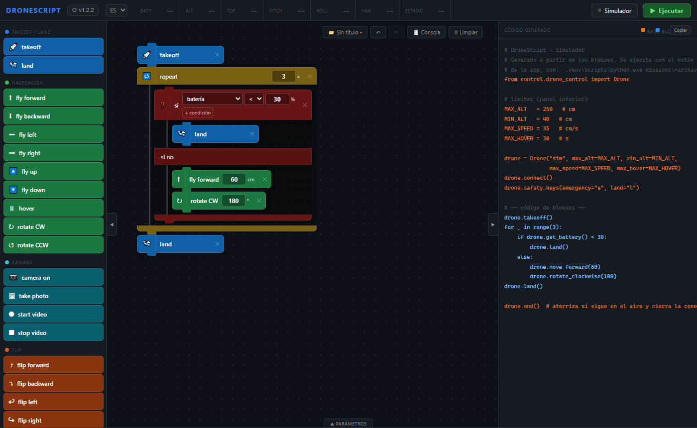
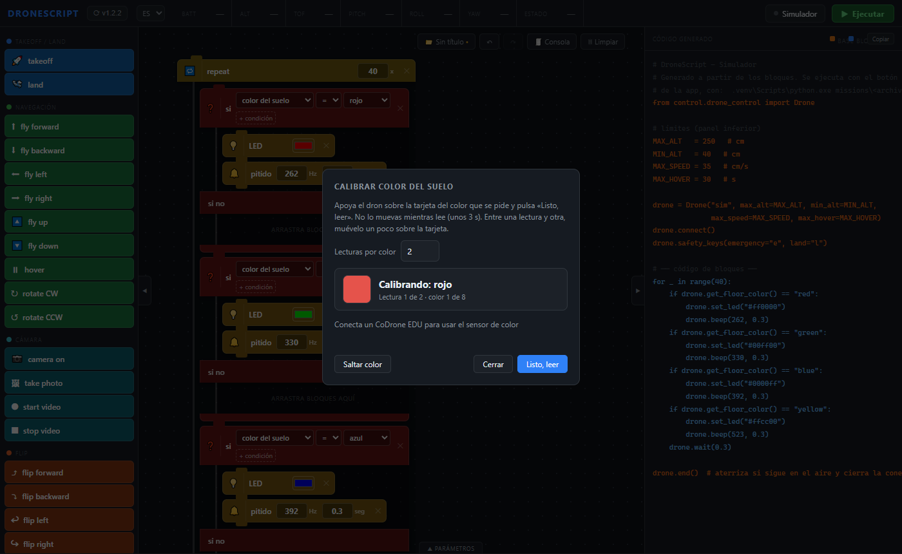

# DroneScript — descargas

Programación por bloques para drones DJI Tello, CoDrone EDU y Parrot Anafi (en pruebas),
y generador de código para VEX AIR. Otros drones se pueden añadir importando su modelo.

**Descargar para Windows:** <https://mrciaphas.github.io/dronescript-descargas/>

Este repositorio sólo contiene la página de descarga y los instaladores
(sección *Releases*).
