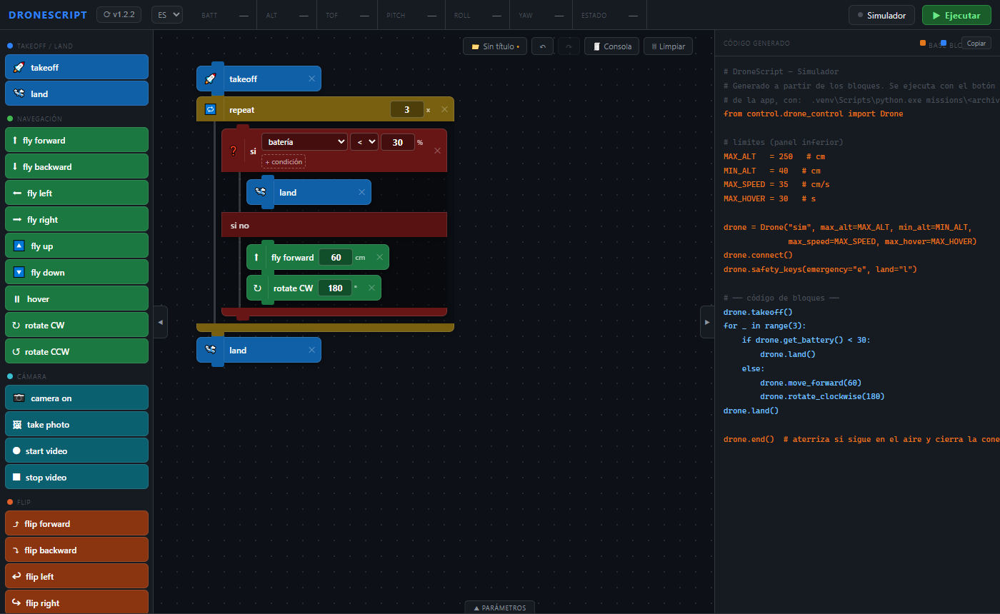
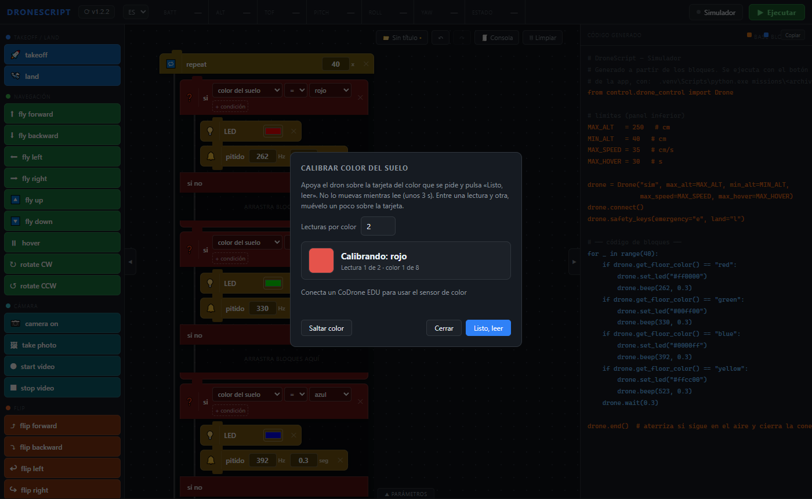

# DroneScript — descargas

Este repositorio sólo contiene las páginas de descarga y los instaladores (sección *Releases*) de dos programas:

- **DroneScript Edu**: programación por bloques para aprender, con DJI Tello, CoDrone EDU, Parrot Anafi,
  un simulador y generador de código para VEX AIR.
  **Descargar para Windows:** <https://mrciaphas.github.io/dronescript-descargas/>
- **DroneScript**: editor de código Python para drones (en desarrollo).
  <https://mrciaphas.github.io/dronescript-descargas/dronescript.html>

